Construyo producto de principio a fin. Vengo del backend enterprise en NTT Data y, en paralelo, lanzo productos propios que están en producción, con dominio y clientes reales.

Antes de programar competí tres años como jugador profesional en UCAM Esports, donde fui tricampeón de España.

[gzlbernal@gmail.com](mailto:gzlbernal@gmail.com) · [LinkedIn](https://www.linkedin.com/in/gonzalobernallopez/) · Disponible para incorporación inmediata

## En producción

| Proyecto | Qué es | Stack |
| --- | --- | --- |
| [**Cardifly**](https://cardifly.es) | Tarjetas de visita NFC con su web comercial. La URL grabada en el chip no se puede cambiar nunca, así que una capa de redirección propia resuelve cada tarjeta a su destino real. | React&nbsp;19 · Vite · TypeScript · Three.js · PHP |
| [**Elopeak**](https://elopeak.lol) | Plataforma bilingüe de coaching: landing, fichas de coaches y reservas, con hreflang, JSON-LD y export estático para hosting compartido. | Next.js&nbsp;16 · React&nbsp;19 · TypeScript · Tailwind&nbsp;4 |
| [**GRX&nbsp;Coaching**](https://grx.coach) | Landing de marca personal sin framework y sin una sola dependencia, con i18n propio. [Ver código](https://github.com/gzbl-dev/GRXCoaching). | HTML · CSS · JavaScript |
| [**Demos&nbsp;Cardifly**](https://gzbl-dev.github.io/barberia-isidro-vela/) | Webs de demostración para negocios locales: carta, horarios, mapa, reserva y datos estructurados. | HTML · CSS · JavaScript |

Cardifly y Elopeak son marcas conjuntas y su código es privado. Detrás de Elopeak también está Coach OS, la herramienta interna con la que gestionamos a los alumnos: Next.js, Supabase con RLS y sincronización con la Riot API.

## Código abierto

**[GameDeck](https://github.com/gzbl-dev/GameDeck-TFG)** · Trabajo de Fin de Ciclo junto a [@vicenttto](https://github.com/vicenttto) 
API REST en Java 21 y Spring Boot 3.3 con Spring Security y JWT, JPA y MySQL versionado con Flyway, más una SPA en React y TypeScript que consume la API de RAWG.

**[Qimob Café](https://github.com/gzbl-dev/prueba-tecnica-qimob)** · Prueba técnica 
Tablero de pedidos e inventario en Svelte 5 con runes sobre SvelteKit. El bloqueo por falta de stock sale de un store derivado, sin casos especiales.

**[OPGRX Scouting](https://github.com/gzbl-dev/OPGRX-Scouting)** · Extensión de navegador 
Extensión Manifest V3 que extrae datos recorriendo el DOM dinámico de una web de estadísticas sin API pública.

## Experiencia

**NTT Data** · Desarrollador backend · Mar 2026 - Jun 2026 
Proyecto AENA. Adaptación a Genesys Cloud de la telefonía de GSR, el sistema de gestión de situaciones de riesgo que comunica los aeropuertos entre sí. Diseñé el apartado de llamadas entre centralitas e integré los servicios CTI de Genesys: autenticación, sesión y control de llamadas. Java, Struts2 y JSP.

## Formación

**CFGS Desarrollo de Aplicaciones Web** · UCAM · 2024 - 2026

## Stack

**Backend** · Java 21, Spring Boot 3, Spring Security, JPA, Struts2, PHP 
**Frontend** · TypeScript, React 19, Next.js 16, Svelte 5, Tailwind CSS 4, Three.js 
**Datos** · MySQL, PostgreSQL con Supabase, PL/SQL, Flyway 
**Herramientas** · Git, Docker, Vercel, Bash
